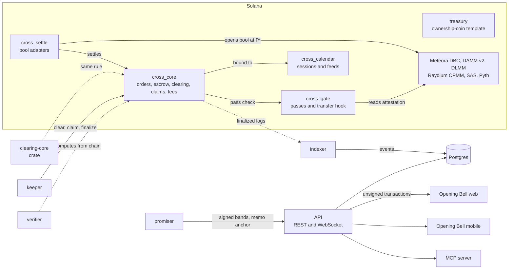

# Opening Cross

One fair price for every new market on Solana.

Opening Cross is an open call-auction protocol. Orders collect during a call period; when it closes, every filled order clears at a single uniform price, found where demand meets supply. Order size buys quantity, not a better price. It is used for token launches, reopens after weekends and halts, unlocks, tenders and recurring crosses. **Opening Bell** is the app built on it.

<!-- live-link: the deployment line is added here -->

> Status: early development on Solana devnet. Nothing is deployed to mainnet, there is no external audit, and nothing here is an offer of securities. What exists and what does not is listed row by row in [`docs/FEATURE_STATUS.md`](docs/FEATURE_STATUS.md).

## What is different

A uniform-price call auction is not new. Metaplex Genesis ships one for launches, and Uncross (Stocklana) runs one for tokenized stocks on devnet ([`DP10`](docs/evidence/DP10-reopen-novelty.md)). What this repository adds is the surrounding machinery, each part tested against a real cluster:

- **Independent verification.** The clearing rule lives in one `no_std` crate used by the program and by the generator of 525 conformance vectors. A second implementation, written from the specification ([ADR-0003](docs/adr/0003-clearing-rule.md)) rather than from that crate, recomputes any cross from its on-chain book and emits a fairness proof.
- **Escrow and refunds.** Every order is fully escrowed in a program-owned vault. Unfilled money is refunded at settlement; a cross that does not print refunds everyone. Anyone can crank settlement and claims, and funds only ever go to their owner.
- **Sealed bids.** A cross can take commit-reveal bids: only a commitment is on chain until the reveal window. A bid that is not revealed is excluded and refunded in full.
- **A market that opens at the price.** Settlement adapters open a Meteora DBC, DAMM v2 or DLMM pool, or a Raydium CPMM pool, at the clearing price. DBC and DAMM v2 pools start at exactly that price; DLMM at the nearest bin.
- **Identity gating.** Entry can require a Solana Attestation Service credential or a Merkle allowlist, and the same gate runs as the transfer hook on the launched token.
- **Print guards.** A cross can refuse to print when volume is too thin, the book too lopsided, or a pinned Pyth feed disagrees or is stale. A calendar program binds crosses to exchange sessions behind a 7-day timelock.
- **A track record that counts misses.** Price bands are signed before a cross closes, graded against what it printed, and anchored in a Merkle root on chain, with the misses and the crosses that never printed counted.

## Try it

- **Live app:** see the line at the top of this file.
- **Check a real devnet cross yourself.** This recomputes a cleared devnet cross from its on-chain book and prints a fairness proof; it needs only Node 22 and pnpm.

  ```sh
  pnpm install --frozen-lockfile
  pnpm --filter @opening-cross/verifier verify ps6kAXQFZ2XawW92G3BALzLdxfEpTWJWaKAtykYnSTH --rpc https://api.devnet.solana.com
  pnpm --filter @opening-cross/verifier conformance      # 525 vectors from the on-chain clearing code
  ```

  The first command ends with `"verified": true` for that cross ([`D5-verifier-devnet-sweep.md`](docs/evidence/D5-verifier-devnet-sweep.md) lists every devnet cross the same way).
- **Run a full cross from a clean project** with `sh examples/ts-quickstart/run.sh` after `sh scripts/build-programs.sh` (Linux or WSL; see Run locally).

## Architecture



The UI never computes money on its own: it shows what the chain and the indexer prove, and every state-changing action is an unsigned transaction built by the API and signed in the user's wallet.

## Programs

| Program | Devnet id | What it does |
|---|---|---|
| `cross_core` | `F5k8EDDXBF24xgt4Y8MMtwPZFH9TikJvJcNmD1NJQPnZ` | The call auction: orders, commit-reveal, sharded book, clearing, claims, fees, guardian pause. Holds all escrow and never calls an AMM. |
| `cross_gate` | `2pE7gApapcdmbk6713VbrWNjEg1iFFrd15SLt1pQwWqr` | Eligibility passes (SAS, Merkle allowlist, open) and transfer locks; also the transfer hook and Token ACL gate. |
| `cross_settle` | `2EVpoks9zhL6VMCE4CryQPyzhSUSxpaGMqaDPKPyJ9WQ` | Settlement adapters: Meteora DBC continuation, DAMM v2, DLMM, Raydium CPMM, each opened at the clearing price. |
| `cross_calendar` | `CxtZKYwS4AoqzLhRfjvBTf6NQgDzb2GQhS3u5iB9XLCN` | Exchange-calendar sessions and approved price feeds behind a timelock. |
| `treasury` | `HoRbUkEXdJSFJFp3yZNgEmNJeniWPEheVUejPGZbVGAd` | Ownership-coin treasury: spending allowance, attestation-gated release, holder liquidation. |
| `cross_settle` (devnet-raydium build) | `4nH5srCTtRFtJuHNmH2Q3x1TSMZ8w3VWBfX7PwwNMpJ5` | The same program built against Raydium's devnet deployment, because Raydium's mainnet id is not a program on devnet ([ADR-0021](docs/adr/0021-raydium-devnet-build.md)). |

All five main programs match the local builds byte for byte ([`L4-verifiable-build.md`](docs/evidence/L4-verifiable-build.md), section 3). The ids are the `declare_id!` values in `programs/*/src/lib.rs`. They are not on mainnet.

## Repository map

| Path | What it is |
|---|---|
| `programs/` | The five programs above. |
| `crates/clearing-core` | The clearing rule, `no_std`, shared by the program and the conformance-vector generator ([ADR-0003](docs/adr/0003-clearing-rule.md)). |
| `crates/opening-cross-cpi` | Rust CPI bindings for other programs; `examples/venue` uses it. |
| `crates/sas-attestation` | Reader for Solana Attestation Service accounts. |
| `packages/sdk`, `packages/*-client` | TypeScript SDK and generated `@solana/kit` clients for each program. |
| `packages/verifier` | Independent verifier, fairness proofs and the conformance suite. |
| `packages/adapters` | Builders for the settlement adapters. |
| `packages/router` | Best-execution reports: a cross against a live Jupiter route. |
| `packages/token-safety`, `packages/authenticity` | Token-2022 issuer-power reports; "is this the issuer's real token". |
| `packages/promises`, `packages/premium` | Signed and graded price bands; the stock-token premium monitor. |
| `services/indexer`, `services/api` | Postgres indexer with a reconciler; REST and WebSocket API that builds unsigned transactions. |
| `services/keeper`, `services/promiser`, `services/premium` | Permissionless keeper; signs, grades and anchors promises; premium rounds on a schedule. |
| `services/mcp` | MCP server for agents: reads and unsigned drafts, no key. |
| `apps/web`, `apps/mobile` | Opening Bell web app (Next.js) and Android app (Expo, Mobile Wallet Adapter). |
| `examples/ts-quickstart`, `examples/venue` | A full cross from a clean project; a third-party program routing orders into a cross with one CPI. |
| `tests/` | LiteSVM program tests, devnet proofs, and the browser harness. |
| `docs/` | [ROADMAP](docs/ROADMAP.md), [feature status](docs/FEATURE_STATUS.md), [ADRs](docs/adr), [security](docs/security), [configuration](docs/CONFIGURATION.md), [evidence](docs/evidence), [human tasks](docs/HUMAN_TASKS.md). |

## Verified numbers

Every figure links to the file that records it. Where a target was missed, the row says so.

| Claim | Result | Evidence |
|---|---|---|
| Conformance vectors from the on-chain clearing code | 525 vectors; the independent TypeScript reference reproduces 525; the program reproduces the 523 it can represent on LiteSVM, 0 mismatches | [D5-conformance](docs/evidence/D5-conformance.md) |
| Verifier over every cross account on devnet | 48 cross accounts: 38 cleared and verified, 0 mismatched, 10 not yet cleared | [D5 sweep](docs/evidence/D5-verifier-devnet-sweep.md) |
| Cost to place an order, 100,000 real orders | 21,633 compute units for every one (target 25,000) | [DP13-scale](docs/evidence/DP13-scale.md) |
| Cost to settle 100,000 orders | 33 transactions, 783,740 compute units, at most 116,476 in one instruction | [DP13-scale](docs/evidence/DP13-scale.md) |
| Bid landing latency on public devnet | p50 2,561 ms, p90 17,652 ms against a 5 s p90 target: **not met**, on a throttled public endpoint; not measured on a paid RPC | [DP13-devnet-latency](docs/evidence/DP13-devnet-latency.md) |
| Cross end to end on devnet | 15 steps pass: launch and sealed crosses clear to the independent reference, fills and refunds exact, mint authority revoked | [C2](docs/evidence/C2-cross-core-devnet.md) |
| Meteora DBC continuation on devnet | 18 steps pass: pool opens at the clearing price, a gated swap runs the hook; `open_dbc_pool` 152,915 and `bind_dbc_mint` 56,129 compute units | [A1](docs/evidence/A1-dbc-continuation-devnet.md) |
| DAMM v2, DLMM, Raydium CPMM seeding on devnet | 18, 19 and 26 steps pass; real swaps match the pool formulas | [A2](docs/evidence/A2-damm-v2-devnet.md), [A3](docs/evidence/A3-dlmm-devnet.md), [A4](docs/evidence/A4-raydium-cpmm-devnet.md) |
| Identity gate with real SAS attestations; calendar; treasury | 22, 22 and 26 steps pass | [C5](docs/evidence/C5-gate-sas-devnet.md), [C6](docs/evidence/C6-calendar-devnet.md), [A5](docs/evidence/A5-treasury-devnet.md) |
| Three keepers racing, one killed mid-work | Four crosses of every shape reach Finalized; 29 steps pass | [D2](docs/evidence/D2-keeper-devnet.md) |
| Signed bands on devnet | Signed before the close, graded, anchored on chain, checked by a stranger; 11 steps pass | [T-trust-devnet](docs/evidence/T-trust-devnet.md) |
| Web accessibility and performance | Axe clean on every route in light and dark at 1440 and 390 px; Lighthouse mobile 97, desktop 100 (performance) | [W1-W2](docs/evidence/W1-W2-web-landing.md) |

The program test suite, the package suites and the browser flows (investor, issuer and trust) run on a local validator and are summarised in [`docs/PROGRESS.md`](docs/PROGRESS.md); the final audit of this repository is [`Z-final-audit.md`](docs/evidence/Z-final-audit.md).

## Run locally

Toolchain ([ADR-0001](docs/adr/0001-toolchain.md)): Rust 1.96.1 (pinned in `rust-toolchain.toml`), Agave 4.0.2, Node 22, pnpm 10.32.1. Install Agave with `sh -c "$(curl -sSfL https://release.anza.xyz/v4.0.2/install)"`. The program tests run on Linux (LiteSVM ships no Windows binary); on Windows, use WSL.

```sh
pnpm install --frozen-lockfile
pnpm -r typecheck
pnpm test                                   # package unit tests
cargo fmt --all --check && cargo clippy --workspace --all-targets -- -D warnings
cargo test --workspace --release            # clearing-core, CPI crate
sh scripts/build-programs.sh                # programs -> target/deploy
sh tests/fixtures/fetch.sh                  # Meteora, Raydium and SAS binaries from mainnet (not redistributed)
DATABASE_URL=postgres://... pnpm --filter @opening-cross/core-tests test   # programs on LiteSVM; Postgres for the indexer and API tests
sh examples/ts-quickstart/run.sh            # clean-room install of the packed packages
```

To run the whole stack (validator, Postgres, indexer, API, web, seeded crosses) and the browser flows, see `tests/e2e/run-all.sh` and `tests/e2e/run-stack.sh`. Every environment variable the processes read is in [`docs/CONFIGURATION.md`](docs/CONFIGURATION.md). CI runs the commands above on a fresh runner for every push.

## Integrate

- **TypeScript SDK.** `@opening-cross/sdk` builds every instruction on `@solana/kit`: `buildCreateCross`, `buildPlaceOrder`, `buildReveal`, `buildSettleBook`, `buildClaim`, `buildFinalize`. [`examples/ts-quickstart/quickstart.ts`](examples/ts-quickstart/quickstart.ts) runs a whole sealed cross and re-checks it with the verifier. The packages are not on a registry yet ([H12](docs/HUMAN_TASKS.md)); use them from a clone or from the tarballs the quickstart packs.
- **Rust CPI.** `opening-cross-cpi` gives program ids, account types and typed calls into `cross_core` and `cross_gate`; [`examples/venue`](examples/venue) forwards a user's order to a cross in one CPI.
- **REST and WebSocket API.** Reads checked against chain, fairness proofs and signed bands, and unsigned transactions for create, place, cancel, reveal, settle, claim and finalize. The route list is on the `/developers` page of the app and in [`services/api/src/server.ts`](services/api/src/server.ts).
- **MCP.** [`services/mcp`](services/mcp) lets an agent read crosses and draft transactions. It holds no key and cannot move funds ([ADR-0019](docs/adr/0019-mcp-server.md)).
- **Verification.** Any third party can implement the clearing rule and run `opening-cross-conformance` against it.

## Security and audit status

- **No external audit has been done.** One is required before any mainnet value; engaging auditors is [H6](docs/HUMAN_TASKS.md). The package for them is [`docs/security/AUDIT_PACKAGE.md`](docs/security/AUDIT_PACKAGE.md).
- [`THREAT_MODEL.md`](docs/security/THREAT_MODEL.md) maps 23 threats to tests and names the open gaps; [`INVARIANTS.md`](docs/security/INVARIANTS.md) lists 13 invariants with their enforcement and tests.
- The programs are tested by property tests and randomized end-to-end runs against an independent implementation. There is no formal proof.
- Upgrade authority is a single key on devnet. Moving it behind a Squads multisig with a timelock is rehearsed on LiteSVM ([ADR-0013](docs/adr/0013-governance.md)) and needs member keys ([H13](docs/HUMAN_TASKS.md)).
- The API limits requests per client address (600 a minute by default). That is not a WAF: a distributed attack, per-key quotas and RPC-side limits are for the hosted deployment.
- There is no public bug bounty or disclosure address yet; both are set up before any mainnet deployment (`ENGINEERING_PRINCIPLES.md`, section 6).

## Roadmap

The build backlog, with acceptance criteria and evidence per item, is [`docs/ROADMAP.md`](docs/ROADMAP.md). What remains is mostly outside the code: a mainnet deployment with caps ([H18](docs/HUMAN_TASKS.md)), the external audit, legal clearance per asset class ([H1](docs/HUMAN_TASKS.md), [H2](docs/HUMAN_TASKS.md)), package registry accounts, paid RPC and hosting, a device run of the Android app, and the first external users. In the code: the Arcium sealed-bid path, holder-vote graduation, the greenshoe and conviction pools, and the rest of the specification marked NOT BUILT in the feature status.

Engineering rules: [`ENGINEERING_PRINCIPLES.md`](ENGINEERING_PRINCIPLES.md). Decisions: [`docs/adr`](docs/adr).

## Licence

Apache-2.0 ([ADR-0002](docs/adr/0002-licence.md)). Meteora and MetaDAO programs are called through their deployed programs and published SDKs, never copied into this repository.
